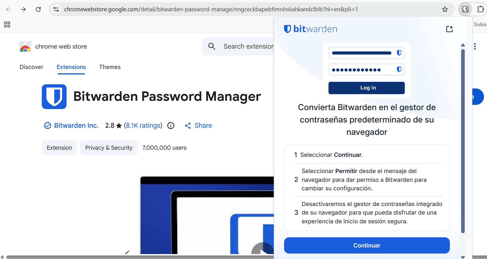
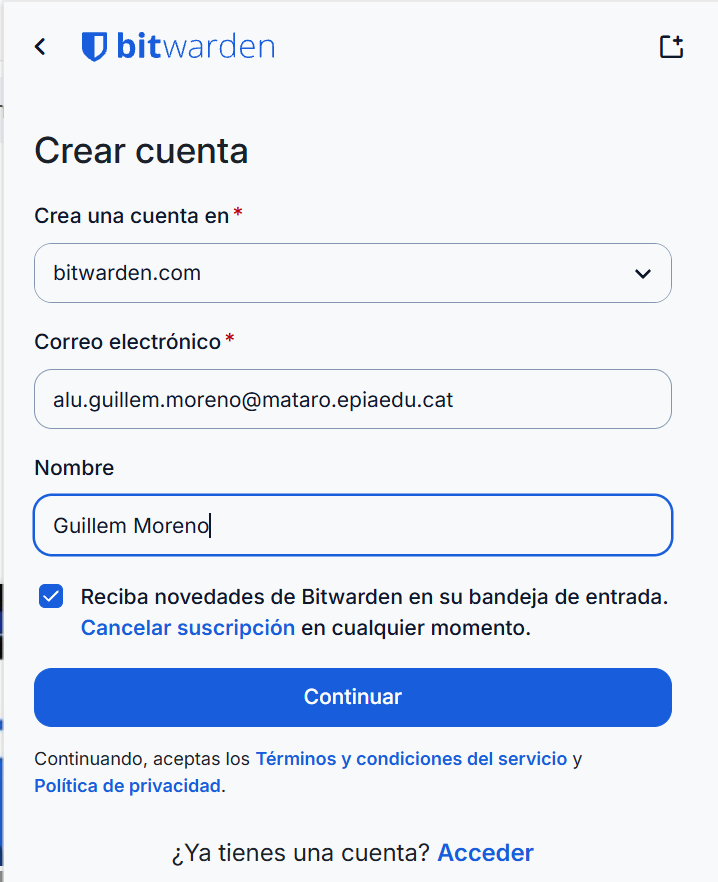
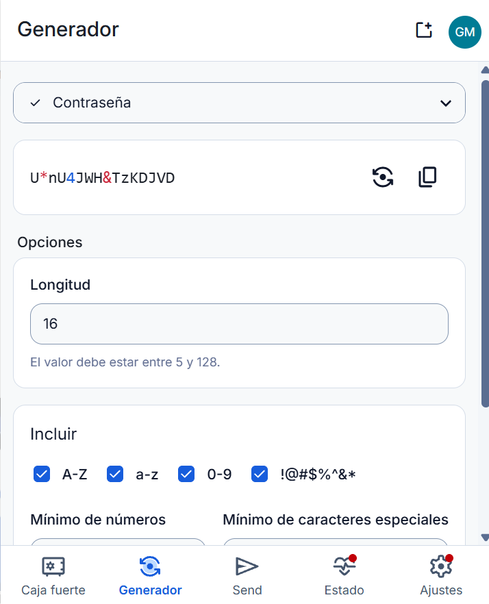
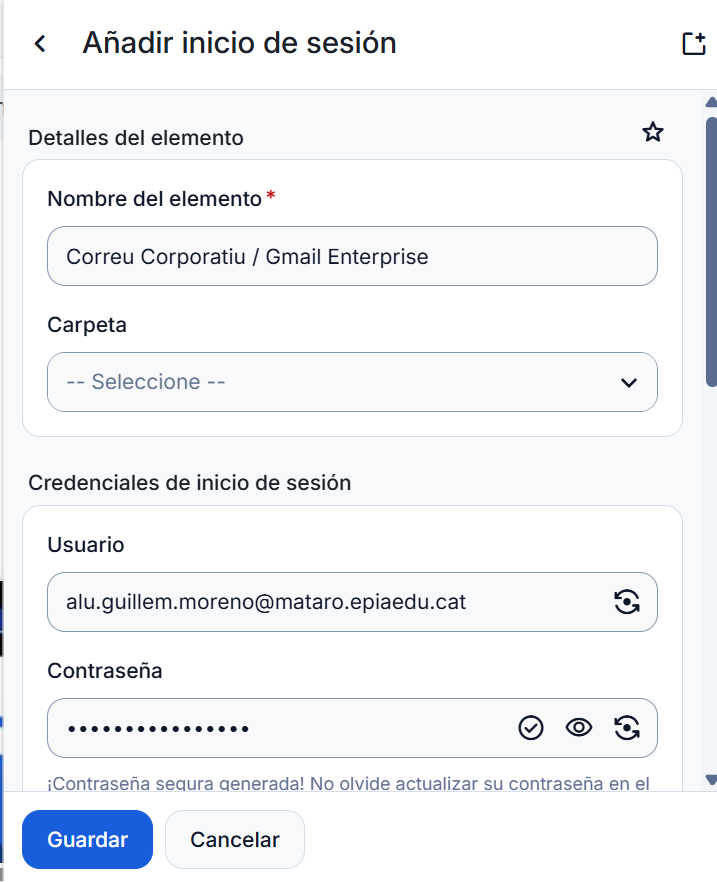
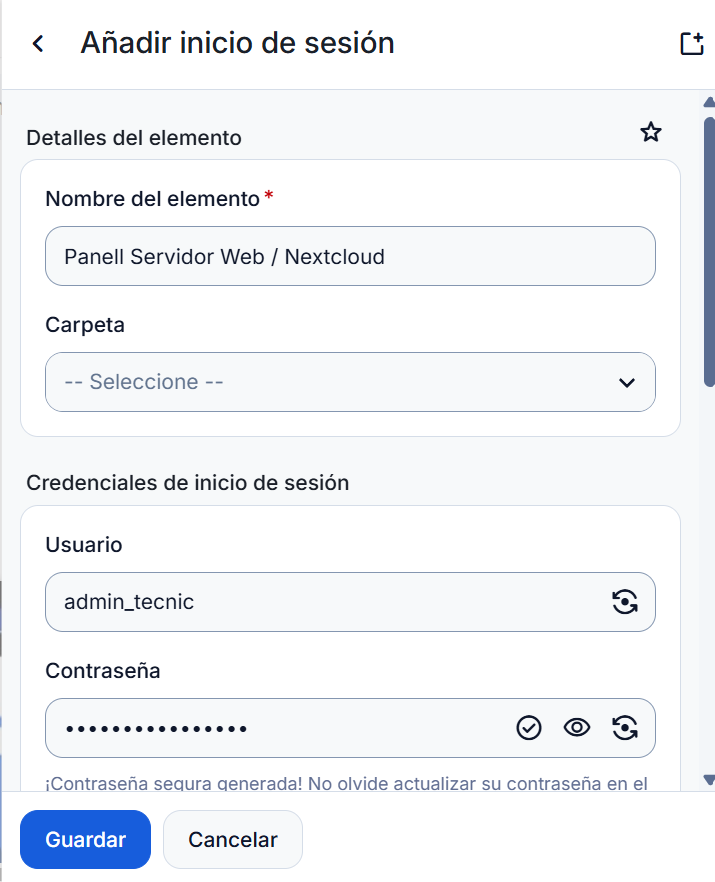
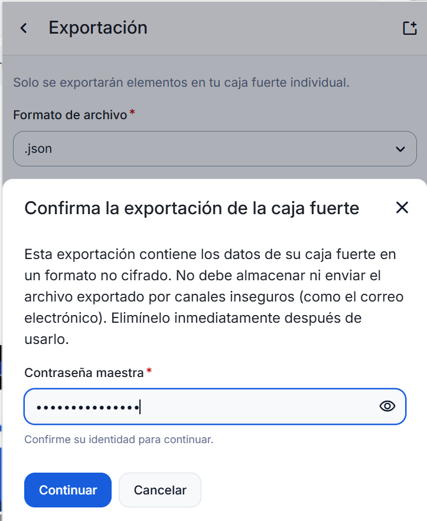

# Activitat: Gestió de contrasenyes

# Fase 1: Anàlisi i justificació

## 1. Introducció

Les contrasenyes són una part important de la seguretat d'una empresa. Si són massa senzilles o es repeteixen en diferents serveis, poden facilitar l'accés de persones no autoritzades.

Alguns dels riscos més habituals són:

- **Atacs de diccionari:** programes que proven moltes paraules i combinacions per descobrir contrasenyes.
- **Credential stuffing:** utilitzar contrasenyes filtrades d'altres pàgines per intentar entrar en comptes de l'empresa.
- **Mala gestió:** guardar contrasenyes en documents o notes sense protecció.

**Per què utilitzar un gestor de contrasenyes?**

1. Permet crear contrasenyes llargues i diferents.
2. Guarda totes les credencials en un espai xifrat.
3. Facilita l'accés als comptes sense haver de recordar totes les contrasenyes.
4. Ajuda a evitar el phishing comprovant els dominis de les pàgines web.

## 2. Comparació entre Bitwarden i KeePassXC

| Característica | Bitwarden | KeePassXC |
|---|---|---|
| Emmagatzematge | Núvol | Fitxer local `.kdbx` |
| Xifratge | AES-256 i Zero-Knowledge | AES-256 / ChaCha20 |
| Sincronització | Automàtica | Manual o amb eines externes |
| Dispositius | PC, mòbil i navegador | Principalment ordinadors |
| Preu | Gratuït amb plans de pagament | Gratuït |
| Internet | Necessari per sincronitzar | No necessita Internet |

## 3. Punts forts i febles

### Bitwarden

**Avantatges:**
- Fàcil d'utilitzar.
- Sincronitza les contrasenyes entre dispositius.
- Permet compartir credencials amb altres membres de l'equip.

**Inconvenients:**
- Necessita Internet per sincronitzar els canvis.
- Les dades s'emmagatzemen en servidors externs.

### KeePassXC

**Avantatges:**
- Les dades es guarden localment.
- No depèn d'Internet.
- És completament gratuït.

**Inconvenients:**
- Cal fer còpies de seguretat manualment.
- Compartir i sincronitzar les contrasenyes és més complicat.

## 4. Elecció final

La nostra recomanació és **Bitwarden**, perquè facilita la feina dels tècnics gràcies a la sincronització automàtica i a les opcions per compartir credencials.

A més, utilitza xifratge de coneixement zero (Zero-Knowledge), que ajuda a protegir les dades dels usuaris.

---

# Fase 2: Guia d'ús tècnica – Bitwarden

En aquesta part veurem com instal·lar i configurar Bitwarden, crear contrasenyes segures i guardar les credencials de diferents serveis.

---

## 1. Instal·lació i creació del compte

### 1.1 Descarregar Bitwarden

**Pas 1.** Obrim el navegador de la màquina virtual amb Windows 11.

**Pas 2.** Entrem a la pàgina oficial:

[https://bitwarden.com/download/](https://bitwarden.com/download/)

**Pas 3.** Descarreguem la versió per a Windows i executem el fitxer d'instal·lació.

**Pas 4.** Seguim els passos de l'assistent fins a acabar.

*Figura 1. Descàrrega i instal·lació de Bitwarden.*

### 1.2 Registrar-se i configurar la contrasenya mestra

**Pas 1.** Obrim Bitwarden i seleccionem "Crear compte".

**Pas 2.** Introduïm el correu electrònic corporatiu.

**Pas 3.** Creem una contrasenya mestra llarga i segura, d'entre 14 i 16 caràcters com a mínim.

**Pas 4.** Si volem, afegim una pista per recordar-la i acabem el registre.

**Important:** La contrasenya mestra protegeix totes les altres. Si la perdem, recuperar el compte pot ser impossible.

*Figura 2. Creació del compte i contrasenya mestra.*

---

## 2. Crear contrasenyes segures

Bitwarden incorpora un generador que permet crear contrasenyes aleatòries.

**Pas 1.** Entrem a l'opció "Generador" (Generator).

**Pas 2.** Configurem les opcions recomanades:

- Tipus: Contrasenya.
- Longitud: Mínim 16 caràcters.
- Majúscules i minúscules.
- Números.
- Símbols.

**Pas 3.** Premem "Generar contrasenya" i copiem el resultat per utilitzar-lo.

*Figura 3. Generador de contrasenyes de Bitwarden.*

---

## 3. Guardar les credencials

### 3.1 Afegir un compte de correu

**Pas 1.** Entrem a "El meu repositori" (Vault) i premem el botó "+" per afegir un element.

**Pas 2.** Omplim les dades:

- **Nom:** Correu Corporatiu / Gmail.
- **Usuari:** usuari@empresa.com.
- **Contrasenya:** Una contrasenya creada amb el generador.
- **Web:** https://mail.google.com

**Pas 3.** Premem "Desar" per guardar la informació.

*Figura 4. Guardar les dades d'un compte de correu.*

### 3.2 Afegir un altre servei web

També podem guardar les dades d'altres aplicacions o serveis.

**Pas 1.** Tornem a prémer "+" per crear un nou element.

**Pas 2.** Introduïm les dades següents:

- **Nom:** Panell Servidor Web / Nextcloud.
- **Usuari:** admin_tecnic.
- **Contrasenya:** Una clau segura de 16 caràcters o més.
- **Web:** https://panell.empresa.local

**Pas 3.** Guardem el nou registre.

*Figura 5. Emmagatzematge de les credencials d'un servei web.*

---

## 4. Còpies de seguretat

### 4.1 Exportar les dades

És important tenir una còpia de les nostres contrasenyes per evitar perdre la informació.

**Pas 1.** Obrim Bitwarden i anem a "Ajustos" (Settings).

**Pas 2.** Seleccionem "Exportar repositori" (Export Vault).

**Pas 3.** Escollim el format de descàrrega:

- **JSON xifrat:** És l'opció recomanada perquè protegeix les dades.
- **CSV o JSON sense xifrar:** No són recomanables perquè les contrasenyes queden visibles.

**Pas 4.** Confirmem l'exportació introduint la contrasenya mestra.

*Figura 6. Exportació de les dades de Bitwarden.*

### 4.2 On guardar el backup?

Per protegir la còpia de seguretat podem utilitzar diferents opcions:

- **USB xifrat:** Guardar el fitxer en un USB protegit amb BitLocker (Windows) o LUKS (Linux).
- **Núvol:** Utilitzar un servei segur, mantenint sempre el fitxer xifrat. També podem utilitzar VeraCrypt o 7-Zip amb AES-256.
- **Lloc físic segur:** Conservar el USB en un armari tancat amb clau o en una caixa forta.

És important no deixar mai les còpies de seguretat sense protecció, ja que poden contenir informació privada de l'empresa.
